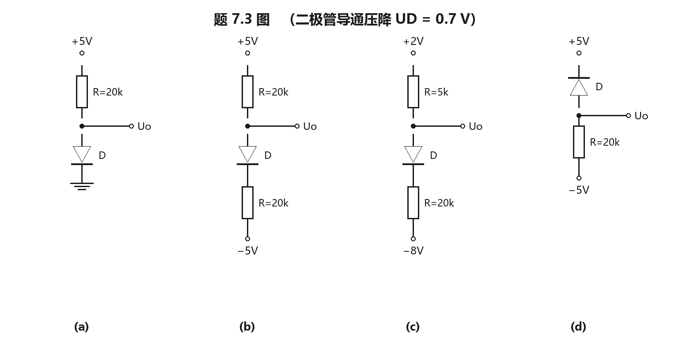
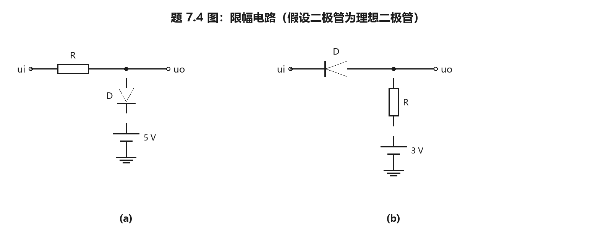
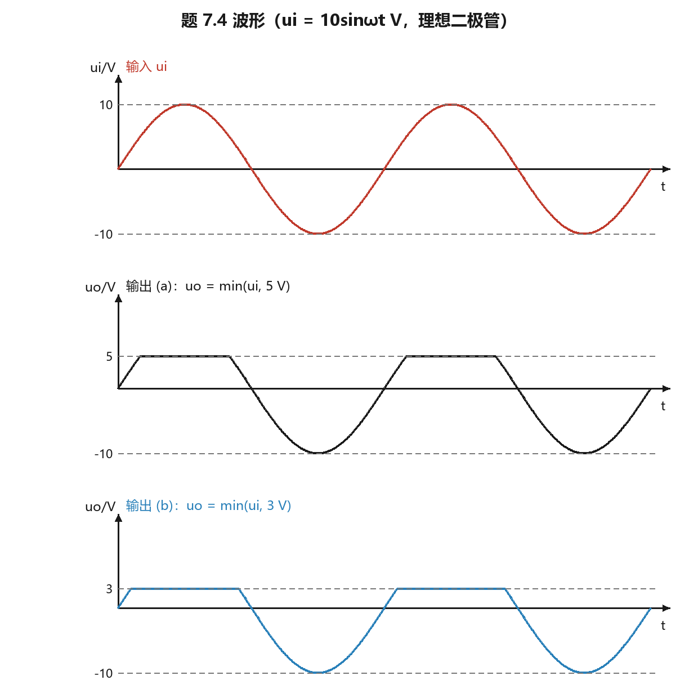
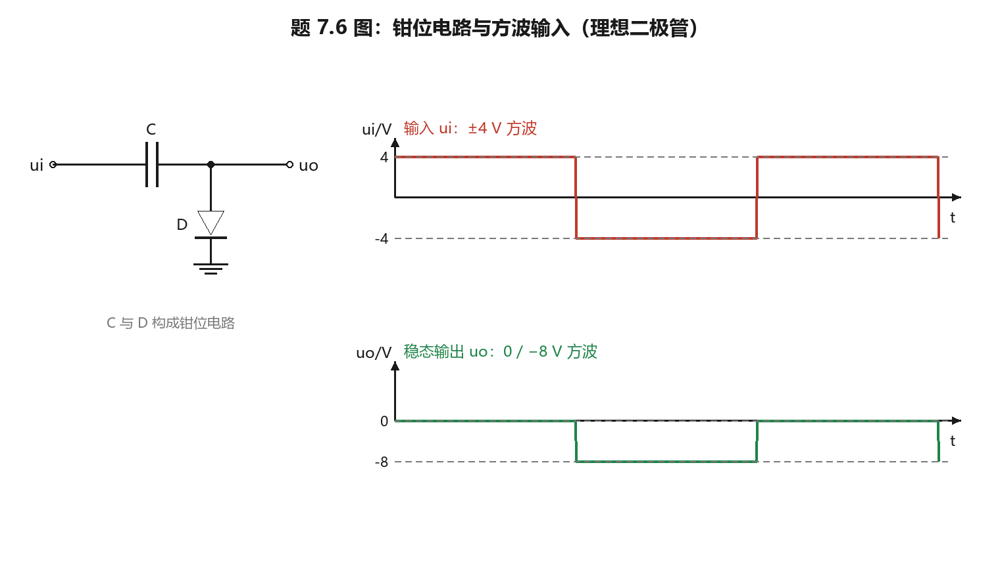
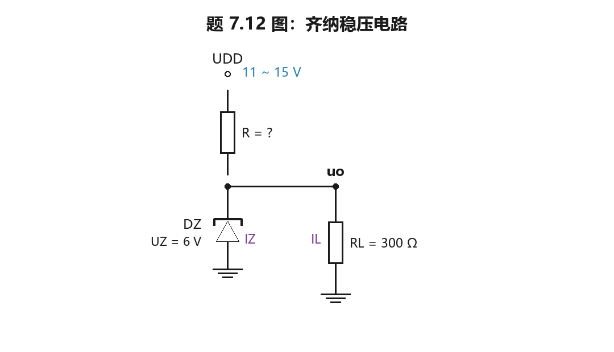

# 第7章 作业　习题 7.3 / 7.4 / 7.6 / 7.12　标准解答

> 题目来源：教材第 7 章课后习题（对应教材图 7-40、7-41、7-43、7-48）。
> 书写规范：**先判断 → 再计算 → 后校验**。考试按这个顺序写，即使算错也能拿到过程分。

---

## 0. 先背 4 个模板（本章所有题都套这个）

### 模板 A：判断二极管通断（电压法）

```text
① 假设二极管断开（画断开后的电路）
② 求阳极电位 VA、阴极电位 VK（相对同一参考点，通常接地端）
③ 判断：
      VA − VK ≥ UD(0.7 V)  →  导通，用 0.7 V 电压源（理想模型用导线）替代
      VA − VK < UD         →  截止，用开路替代
④ 按替代后的电路重新求解
⑤ 校验：导通时电流必须 > 0；截止时反压必须 < UD，否则假设错误，重来
```

### 模板 B：限幅电路

```text
① 先假设 D 截止 → uo = ui（输出跟着输入走）
② 找 D 开始导通的临界 uo（由参考电压决定）
③ 一旦 D 导通，uo 被"钉"在该电平上（理想模型无压降，实际加 0.7 V）
④ 分段写出 uo 与 ui 的关系式，再画波形
```

### 模板 C：钳位电路

```text
① 从 D 导通的半个周期开始分析（此时 C 充电）
② 求出 C 上充到的电压 UC，方向为"左板 − 右板"
③ D 截止时 C 无放电回路 → UC 保持不变，相当于一个恒压源串在输入与输出之间
④ uo = ui − UC，波形形状不变，整体平移 UC
```

### 模板 D：稳压电路

```text
① 断开稳压管，求其两端戴维南等效 Uth、Rth
② Uth > UZ → 击穿稳压；否则截止
③ iz = (Uth − UZ)/Rth，uo = UZ（rz≠0 时 uo = UZ0 + iz·rz）
④ 校验 IZmin ≤ iz ≤ IZmax
```

---

## 1. 习题 7.3

### 题目

图 7-40 的四个电路中，二极管正向导通压降 `UD = 0.7 V`，求输出电压 `Uo`（及电流 `I`）。



### 解前分析

四个电路都是"电源 → 电阻 → 二极管 → 电源/地"的串联回路，**只有一个回路**，
所以统一用模板 A：先断开 D 求 `uD`，再按导通/截止两种情况分别算。

> 关键：Uo 取在**电阻与二极管之间**的节点（(d) 中该节点在二极管下方）。

---

### (a) +5 V — R=20 kΩ — Uo — D — 地

**① 判断**

断开 D：回路无电流，R 上无压降，故

```text
VA = +5 V（阳极，接 Uo 节点）
VK = 0 V （阴极，接地）
uD = 5 − 0 = 5 V > 0.7 V  →  D 正偏导通
```

**② 计算**

导通后用 0.7 V 电压源替代 D，回路 KVL：

```text
5 = I × 20k + 0.7
I = (5 − 0.7) / 20k = 4.3 / 20k = 0.215 mA
Uo = UD = 0.7 V
```

**③ 答**

```text
I = 0.215 mA ，  Uo = 0.7 V
```

> 注意：Uo 是二极管两端电压，不是电阻上的电压；`I > 0` 说明导通假设成立。

---

### (b) +5 V — R=20 kΩ — Uo — D — R=20 kΩ — (−5 V)

**① 判断**

断开 D：两电阻都不通电流，故

```text
VA = +5 V（上方电阻无压降）
VK = −5 V（下方电阻无压降）
uD = 5 − (−5) = 10 V > 0.7 V  →  D 导通
```

**② 计算**

导通后电流自上而下流过两个 20 kΩ 电阻和二极管：

```text
5 − I×20k − 0.7 − I×20k = −5
5 + 5 − 0.7 = I × 40k
I = 9.3 / 40k = 0.2325 mA
```

Uo 在二极管**上方**节点：

```text
Uo = 5 − I × 20k = 5 − 0.2325 × 20 = 5 − 4.65 = 0.35 V
```

**③ 答**

```text
I = 0.2325 mA ，  Uo = 0.35 V
```

> 检验：0.35 V 是**节点对地电压**，不是二极管压降；二极管压降仍是 0.7 V。
> 因为两个 20 kΩ 把 (5 V, −5 V) 分成对称两段，所以节点电压 = 0.7 V 的中心值附近。

---

### (c) +2 V — R=5 kΩ — Uo — D — R=20 kΩ — (−8 V)

**① 判断**

断开 D：

```text
VA = +2 V（5 kΩ 无电流）
VK = −8 V（20 kΩ 无电流）
uD = 2 − (−8) = 10 V > 0.7 V  →  D 导通
```

**② 计算**

```text
2 − I×5k − 0.7 − I×20k = −8
2 + 8 − 0.7 = I × 25k
I = 9.3 / 25k = 0.372 mA
Uo = 2 − I × 5k = 2 − 0.372 × 5 = 2 − 1.86 = 0.14 V
```

**③ 答**

```text
I = 0.372 mA ，  Uo = 0.14 V
```

> 与 (b) 对比：总电压一样是 9.3 V，但总电阻从 40 kΩ 变为 25 kΩ，电流变大；
> 而 Uo 由**上电阻**决定，上电阻只有 5 kΩ，所以节点电压被拉得更低。

---

### (d) +5 V — D（阴极朝上）— Uo — R=20 kΩ — (−5 V)

**① 判断**

断开 D：回路无电流，R 上无压降，故

```text
VA = −5 V（阳极在下方节点）
VK = +5 V（阴极接 +5 V）
uD = −5 − 5 = −10 V < 0.7 V  →  D 截止
```

**② 计算**

截止即开路，回路电流为零：

```text
I = 0
Uo = −5 V（节点只经 20 kΩ 接 −5 V，无电流 → 无压降）
```

**③ 校验**

`uD = −10 V`（反偏 10 V），确实小于 0.7 V，截止假设成立。

**④ 答**

```text
I = 0 ，  Uo = −5 V
```

> 这是四问里唯一的"截止"情形。判断依据是**阴极电位高于阳极**，二极管被反接。

---

### 7.3 答案汇总

| 小问 | 二极管状态 | 电流 I | 输出电压 Uo |
|---|---|---|---|
| (a) | 导通 | 0.215 mA | 0.7 V |
| (b) | 导通 | 0.2325 mA | 0.35 V |
| (c) | 导通 | 0.372 mA | 0.14 V |
| (d) | **截止** | 0 | −5 V |

**规范书写四步**：画断开电路 → 标 VA/VK → 判断并写依据 → 代入 0.7 V 求值并校验。

---

## 2. 习题 7.4

### 题目

限幅电路如图 7-41(a)、(b)，输入为图 7-41(c) 所示 `ui = ±10 V` 正弦波。
二极管为**理想二极管**，分别画出输出电压 `uo` 的波形。



### 解前分析

两个电路结构不同：

- (a)：`R` 与 `ui` 串联，二极管支路（D 串 5 V 电源）**并联**在输出端；
- (b)：二极管**串**在 `ui` 与输出之间，输出端再用 `R` 接 3 V 电源。

理想二极管：导通 = 短路（0 V），截止 = 开路。

---

### (a) D 与 5 V 电源串联后并在输出端

**① 假设 D 截止**

断开支路 → 输出端只由 `ui` 经 `R` 供给，且输出开路（无负载电流），R 上无压降：

```text
uo = ui
```

**② 找临界点**

D 的阳极接 `uo`，阴极接 `+5 V`（电池正极）。理想二极管一旦 `uo > 5 V` 就导通：

```text
uo = ui 一直上升，当 ui 超过 5 V 时 D 导通
```

**③ 分段讨论**

| 条件 | D 状态 | 输出 |
|---|---|---|
| `ui < 5 V` | 截止 | `uo = ui` |
| `ui ≥ 5 V` | 导通 | `uo = 5 V`（被钳住） |

合写：

```text
uo = min(ui , 5 V)
```

**④ 波形**

- 正半周超过 5 V 的部分被"削平"在 5 V；
- 负半周完全跟随输入，最低到 −10 V。

---

### (b) 二极管串联在输入端，输出端经 R 接 3 V

**① 假设 D 截止**

D 截止时电路被断开，输出端只经 `R` 接 +3 V，无电流 → 无压降：

```text
uo = 3 V
```

**② 判断 D 是否真的截止**

D 的阳极在 `uo` 侧（3 V），阴极在 `ui` 侧：

```text
uD = uo − ui = 3 − ui
若 ui < 3 V  →  uD > 0  →  D 应导通（假设错误）
若 ui > 3 V  →  uD < 0  →  D 截止（假设成立）
```

**③ 分段讨论**

| 条件 | D 状态 | 输出 |
|---|---|---|
| `ui < 3 V` | 导通（短路） | `uo = ui` |
| `ui ≥ 3 V` | 截止 | `uo = 3 V` |

合写：

```text
uo = min(ui , 3 V)
```

> 物理解释：D 导通时把输出"贴"在输入上；一旦输入高于 3 V，D 反偏断开，
> 输出被 R 拉回 3 V —— 所以高出的部分被削掉。

---

### 两问的传输特性与波形

| 电路 | 传输特性 | 输出范围 | 削顶电平 |
|---|---|---|---|
| (a) | `uo = min(ui, 5 V)` | −10 V ~ +5 V | +5 V |
| (b) | `uo = min(ui, 3 V)` | −10 V ~ +3 V | +3 V |



**画图要点（阅卷看这三点）**

1. 削顶处**必须是水平直线**，且与横轴平行；
2. 标注削顶电平（5 V / 3 V）和负峰值（−10 V）；
3. 转折点位置要与输入 `ui = 5 V`（或 3 V）的时刻对齐（可用虚线辅助）。

**易错**

- ✗ 把 (b) 也当成"并联限幅"来算，得到 `uo = ui + 3`；
- ✗ 忘记"理想二极管"→ 多加 0.7 V；
- ✗ 削顶后仍画成正弦曲线（应是平直线段）。

---

## 3. 习题 7.6

### 题目

图 7-43(a) 钳位电路中，输入为峰峰值 8 V 的**方波**（±4 V），如图 (b)。
二极管为理想二极管，画出**稳态**输出电压波形。



### 解前分析

电路：`ui` — C — 输出节点 `uo`；节点经 D 接地。

- D 的**阳极接 uo，阴极接地**（图中三角形朝下）→ **uo > 0 时 D 导通**。
- C 串联在信号通路里，充上电压后相当于一个恒压源。

按模板 C：**从 D 导通的半周（即 ui 为正的半周）开始分析**。

---

### 逐步推导

设 `uC = u左 − u右 = ui − uo`（电容左板为正时的电压）。

**第 1 个半周：ui = +4 V（D 导通）**

初始 C 未充电，`uC = 0` → `uo = ui − uC = 4 V`。

`uo = +4 V > 0` → D 正偏导通 → `uo` 被钳到 0 V，C 被充电：

```text
uC = ui − uo = 4 − 0 = 4 V
```

**第 2 个半周：ui = −4 V（D 截止）**

```text
uo = ui − uC = −4 − 4 = −8 V
```

`uo = −8 V < 0` → D 反偏截止 → C 无放电回路（输出端开路），`uC` 保持 4 V。

**第 3 个半周：ui = +4 V**

```text
uo = 4 − 4 = 0 V
```

`uo = 0` → D 处于临界（零压降），无充电电流，`uC` 仍为 4 V。

**此后周期性重复**

```text
ui = +4 V  →  uo = 0 V
ui = −4 V  →  uo = −8 V
```

---

### 结果

```text
稳态输出：uo 为 0 / −8 V 的方波，与 ui 同相；
即 uo = ui − 4 V，波形整体下移 4 V，峰峰值仍为 8 V。
```

**与输入的关系**

| 量 | 输入 ui | 输出 uo |
|---|---|---|
| 最大值 | +4 V | 0 V |
| 最小值 | −4 V | −8 V |
| 峰峰值 | 8 V | 8 V |
| 直流分量 | 0 V | −4 V |

> 钳位电路的三个"不变"：**峰峰值不变、波形形状不变、频率不变**；变的只有**直流电平**。

**易错**

- ✗ 从负半周开始分析 → 会把输出算成 0 ~ +8 V（方向反了）；
- ✗ 认为 C 会放电 → 输出节点开路，二极管截止时 C 没有回路放电；
- ✗ 把 uC 当成 8 V → 正确的是 **4 V**（等于输入峰值，不是峰峰值）。

---

## 4. 习题 7.12

### 题目

稳压电路如图 7-48：`RL = 300 Ω`，齐纳管 `UZ = 6 V`，`IZmax = 40 mA`，`IZmin = 5 mA`，
电源电压 `UDD = 11 ~ 15 V` 波动。求限流电阻 `R` 的取值范围。



### 解前分析

稳压管正常工作时 `uo = UZ = 6 V`（假设始终击穿），于是：

```text
负载电流（恒定）：IL = UZ / RL = 6 / 0.3k = 20 mA
限流电阻电流：    IR = (UDD − UZ) / R
稳压管电流：      IZ = IR − IL = (UDD − 6)/R − 20mA
```

**两条边界条件**

| 最坏情况 | 约束 | 决定 |
|---|---|---|
| `UDD` 最高（15 V） | `IZ ≤ IZmax = 40 mA` | `R` 的**下限** `Rmin` |
| `UDD` 最低（11 V） | `IZ ≥ IZmin = 5 mA` | `R` 的**上限** `Rmax` |

> 记法：**R 小 → 电流大 → 怕超上限（配 UDD max）；R 大 → 电流小 → 怕低于下限（配 UDD min）**。

---

### ① 求 R 的下限

`UDD = 15 V`，`IZ` 取最大值 40 mA：

```text
IZmax = (UDD,max − UZ)/Rmin − UZ/RL
40m = (15 − 6)/Rmin − 20m
40m + 20m = 9/Rmin
60m = 9/Rmin
Rmin = 9 / 60m = 150 Ω
```

### ② 求 R 的上限

`UDD = 11 V`，`IZ` 取最小值 5 mA：

```text
IZmin = (UDD,min − UZ)/Rmax − UZ/RL
5m = (11 − 6)/Rmax − 20m
5m + 20m = 5/Rmax
25m = 5/Rmax
Rmax = 5 / 25m = 200 Ω
```

### ③ 结果

```text
150 Ω ≤ R ≤ 200 Ω
```

### ④ 校验（重要，别省）

取两端值验证稳压管是否始终工作在击穿区：

| R | UDD | IZ 计算 | 是否在 5 ~ 40 mA |
|---|---|---|---|
| 150 Ω | 15 V | 9/150 − 20m = 60 − 20 = 40 mA | 恰好上限 ✓ |
| 150 Ω | 11 V | 5/150 − 20m = 33.3 − 20 = 13.3 mA | ✓ |
| 200 Ω | 15 V | 9/200 − 20m = 45 − 20 = 25 mA | ✓ |
| 200 Ω | 11 V | 5/200 − 20m = 25 − 20 = 5 mA | 恰好下限 ✓ |

四个端点全部落在 `[5 mA, 40 mA]` 内，且 `IZ > 0` 说明始终处于击穿状态，
**"uo = 6 V"的前提成立**，结论有效。

**答：`150 Ω ≤ R ≤ 200 Ω`**

**易错**

- ✗ 忘记减去负载电流 20 mA，把 `IR` 直接当 `IZ`；
- ✗ 把两个最坏情况配反（用 11 V 求 Rmin），导致范围颠倒；
- ✗ 只用不等式解出区间，不做端点校验 —— 有些题会因此漏掉"稳压失效"的情况；
- ✗ 单位混用：`IZ` 用 mA、`R` 用 kΩ 时要统一（1 mA × 1 kΩ = 1 V）。

---

## 5. 四道题的共同套路（考前速览）

| 题号 | 电路类型 | 核心方法 | 关键结论 |
|---|---|---|---|
| 7.3 | 单回路多电源 | 电压法判通断 + KVL | (d) 是反接截止，其余导通 |
| 7.4 | 限幅 | 假设截止 → 找临界 → 分段 | `uo = min(ui, 5 V)` / `min(ui, 3 V)` |
| 7.6 | 钳位 | 从导通的半周开始 + C 恒压 | 输出 `uo = ui − 4 V`（0 / −8 V） |
| 7.12 | 稳压 | 两端最坏情况 + 校验 | `150 Ω ~ 200 Ω` |

**四句话总结**

```text
判断通断看电位差，导通就代 0.7 V；
限幅削掉超出部分，输出取 min；
钳位搬移直流电平，形状峰峰值不变；
稳压两头卡电流，最后一定验区间。
```

---

## 6. 附：本页图片说明

| 文件 | 内容 |
|---|---|
| `images/hw7_3_circuits.png` | 题 7.3 四个电路（重绘） |
| `images/hw7_4_circuits.png` | 题 7.4 两个限幅电路（重绘） |
| `images/hw7_4_waveforms.png` | 题 7.4 输入与两组输出波形 |
| `images/hw7_6_circuit_wave.png` | 题 7.6 钳位电路 + 输入/输出方波 |
| `images/hw7_12_circuit.png` | 题 7.12 稳压电路 |

> 图形按教材电路重绘，元件参数与教材一致；波形按理想二极管模型绘制。


## 附：图片清单（手机 App 内点开查看）

> GitHub 手机 App 不渲染 Markdown 里的相对路径图片（已知缺陷）。
> 在 App 里点下面的链接可直接打开对应图片；用手机/电脑浏览器阅读则图片会正常内嵌显示。

| # | 图片 | 所属章节 |
|---|---|---|
| 1 | [题 7.3 电路](https://raw.githubusercontent.com/JZG-1/study_materials/main/%E6%A8%A1%E7%94%B5/%E7%AC%AC7%E7%AB%A0_%E4%BA%8C%E6%9E%81%E7%AE%A1%E5%8F%8A%E5%85%B6%E5%BA%94%E7%94%A8%E7%94%B5%E8%B7%AF/%E4%BD%9C%E4%B8%9A/images/hw7_3_circuits.png) | 题目 |
| 2 | [题 7.4 电路](https://raw.githubusercontent.com/JZG-1/study_materials/main/%E6%A8%A1%E7%94%B5/%E7%AC%AC7%E7%AB%A0_%E4%BA%8C%E6%9E%81%E7%AE%A1%E5%8F%8A%E5%85%B6%E5%BA%94%E7%94%A8%E7%94%B5%E8%B7%AF/%E4%BD%9C%E4%B8%9A/images/hw7_4_circuits.png) | 题目 |
| 3 | [题 7.4 波形](https://raw.githubusercontent.com/JZG-1/study_materials/main/%E6%A8%A1%E7%94%B5/%E7%AC%AC7%E7%AB%A0_%E4%BA%8C%E6%9E%81%E7%AE%A1%E5%8F%8A%E5%85%B6%E5%BA%94%E7%94%A8%E7%94%B5%E8%B7%AF/%E4%BD%9C%E4%B8%9A/images/hw7_4_waveforms.png) | 两问的传输特性与波形 |
| 4 | [题 7.6 电路与波形](https://raw.githubusercontent.com/JZG-1/study_materials/main/%E6%A8%A1%E7%94%B5/%E7%AC%AC7%E7%AB%A0_%E4%BA%8C%E6%9E%81%E7%AE%A1%E5%8F%8A%E5%85%B6%E5%BA%94%E7%94%A8%E7%94%B5%E8%B7%AF/%E4%BD%9C%E4%B8%9A/images/hw7_6_circuit_wave.png) | 题目 |
| 5 | [题 7.12 电路](https://raw.githubusercontent.com/JZG-1/study_materials/main/%E6%A8%A1%E7%94%B5/%E7%AC%AC7%E7%AB%A0_%E4%BA%8C%E6%9E%81%E7%AE%A1%E5%8F%8A%E5%85%B6%E5%BA%94%E7%94%A8%E7%94%B5%E8%B7%AF/%E4%BD%9C%E4%B8%9A/images/hw7_12_circuit.png) | 题目 |
<!-- image-index -->
