# 第7章 二极管及其应用电路 · 学习笔记

> 配套资料：`模电/PPT/chap7.pptx`（共 47 页，本地文件，未上传 GitHub）
> 整理目标：把 PPT 中分散的文字、公式和图片压缩成一条主线，考前只看这一份。
> 配套作业：[习题 7.3 / 7.4 / 7.6 / 7.12 标准解答](作业/习题7.3-7.4-7.6-7.12_标准解答.md)

---

## 0. 知识地图（先看这个）

```text
半导体物理 ──► PN结 ──► 二极管 ──┬─► 大信号模型 ──► 整流 / 限幅 / 钳位 / 门电路
    7.1         7.1       7.2     │       7.3                7.4
                                   ├─► 小信号模型 ──► 交流小信号分析
                                   │       7.3
                                   ├─► 反向击穿 ──► 齐纳二极管 / 稳压电路
                                   │     7.2/7.6
                                   └─► 结电容 ──► 高频 / 开关特性
                                         PPT 45–47
```

### 本章 6 个必会

1. 说明 PN 结正偏 / 反偏时空间电荷区、电阻、电流如何变化（单向导电性）。
2. 读懂二极管伏安特性：Si 管 0.7 V、死区电压、反向饱和电流、击穿电压。
3. 会用理想 / 恒压降 / 折线三种大信号模型；会判断二极管通断（含多只二极管）。
4. 会求静态工作点（负载线 / 图解法），会算小信号电阻 `rd = 26 mV / ID`。
5. 会画半波 / 全波整流、峰值检测、限幅、钳位的输出波形（本章最大分值）。
6. 会分析齐纳稳压电路：先断开求戴维南，再判断截止 / 击穿，最后校验 `IZmin ≤ iz ≤ IZmax`。

### 一张表记住关键数字

| 量 | 数值 / 结论 | 备注 |
|---|---|---|
| 硅管导通压降 | ≈ 0.7 V | PPT 明确 |
| 锗管导通压降 | ≈ 0.3 V | 常见教材值，PPT 未强调 |
| 热电压 `UT` | 26 mV（T = 300 K） | 小信号公式用 |
| 电流每增大 10 倍 | 电压只需增加 ≈ 60 mV | `UT·ln10 ≈ 60 mV` |
| 温度每升 10 ℃ | `Is` 约翻倍 | `Is(T2)=Is(T1)·2^((T2−T1)/10)` |
| Si 原子浓度 | 5×10²² cm⁻³ | 本征半导体 |
| 室温电子浓度 | 1.5×10¹⁰ cm⁻³ | 本征半导体，数量很少 |

### 记忆口诀

> **N 电 P 空**；**正偏窄、反偏宽**；**导通 0.7、理想 0、折线 Uon+rD**；
> **小信号 rd = 26/ID**；**钳位搬电平、限幅削幅度**；
> **稳压管反着接，先断后比再校验**。

---

## 1. 半导体基础（7.1）

### 1.1 三类物质

- 导体、半导体、绝缘体。
- 半导体材料：
  - 元素半导体：硅 Si、锗 Ge；
  - 化合物半导体：砷化镓 GaAs。
- 半导体的三个“敏感”：**光敏、热敏、掺杂**（掺入杂质后导电能力大大增强）。

### 1.2 本征半导体

- 硅原子为 4 价，靠共价键组成晶体。
- 绝对零度时没有自由移动的载流子 → 相当于绝缘体。
- 室温或光照下发生**本征激发**：成对产生自由电子和空穴；电子与空穴相遇会**复合**（成对消失）。
- 两种载流子：**自由电子（负）、空穴（正）**。
- 空穴导电的实质：共价键中的价电子依次填补空穴，等效为空穴反向移动。**不是空穴本身在跑。**
- 数量级：Si 原子浓度约 5×10²² cm⁻³，但室温自由电子只有约 1.5×10¹⁰ cm⁻³ → 载流子很少，导电能力弱，所以叫“半导体”。

### 1.3 杂质半导体（选择题常考）

| 类型 | 掺入杂质 | 多子 | 少子 | 不能移动的离子 | 记忆 |
|---|---|---|---|---|---|
| N 型 | 五价元素（磷 P、砷 As） | 自由电子 | 空穴 | 正离子 | **N = Negative，电子带负电** |
| P 型 | 三价元素（硼 B） | 空穴 | 自由电子 | 负离子 | **P = Positive，空穴带正电** |

- 多子浓度 ≈ 杂质浓度，基本不随温度变化；少子浓度很低，随温度变化明显 → **二极管温度漂移的根源**。
- 杂质半导体整体仍**电中性**（离子电荷与载流子电荷平衡）。
- 误区：N 型半导体不带负电，P 型也不带正电，只是“多数载流子”不同。

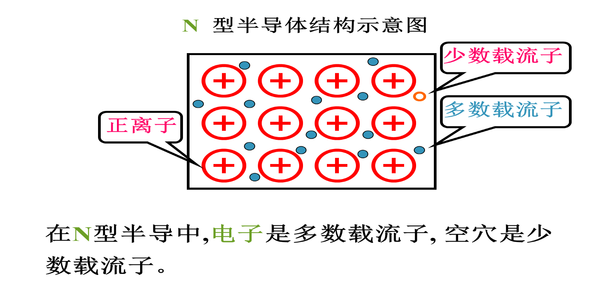

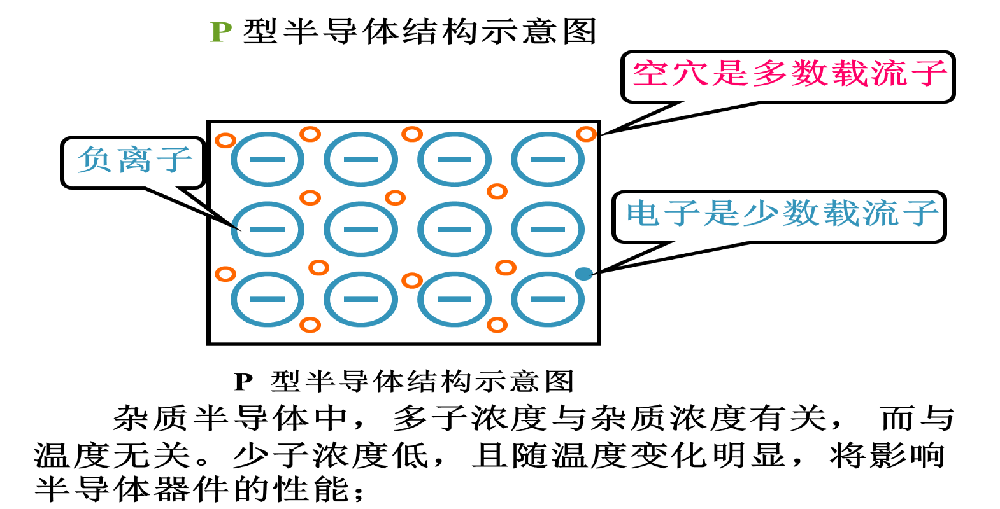

### 1.4 PN 结（本章的地基）

**形成过程**

P 区空穴向 N 区扩散、N 区电子向 P 区扩散，在交界面附近复合；留下不能移动的正、负离子 → 形成**空间电荷区（耗尽层）**；产生**内电场（方向 N → P）**；内电场阻止扩散、促进漂移；当扩散 = 漂移时达到平衡，结宽稳定。

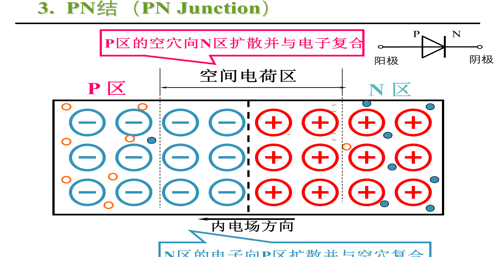

**正偏 vs 反偏（必背）**

| 项目 | 正偏 | 反偏 |
|---|---|---|
| 接法 | P 接电源正，N 接负 | P 接电源负，N 接正 |
| 外电场 | 与内电场**相反** | 与内电场**相同** |
| 空间电荷区 | 变窄 | 变宽 |
| 载流子运动 | 扩散 > 漂移 | 漂移 > 扩散 |
| 电阻 | 低电阻 | 高电阻 |
| 电流 | 较大的正向电流 | 很小的反向饱和电流 `Is` |
| 结论 | 导通 | 截止 |

- 内电场方向：**N 区指向 P 区**。
- “加正向电压”指 **P 区电位高于 N 区**。
- 二极管符号：三角形指向 = 正向电流方向；P 端 = 阳极，N 端 = 阴极。
- 结论：**单向导电性** —— 正偏低阻大电流，反偏高阻小电流。
- PN 结加上封装和引线，就是半导体二极管。

### 1.4.1 直观理解：为什么正偏窄、反偏宽？

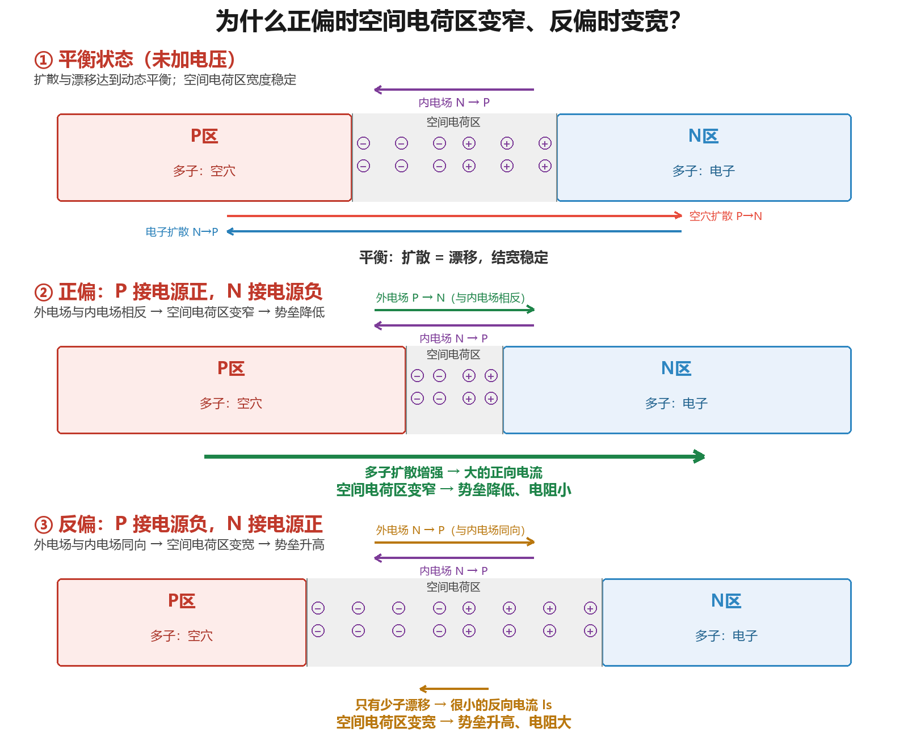

先抓住三个角色：

1. **扩散**：由浓度差驱动。P 区空穴多 → 往 N 区跑；N 区电子多 → 往 P 区跑。
2. **漂移**：由电场力驱动。内电场方向是 **N → P**；空穴顺着电场跑（N → P），电子逆着电场跑（P → N）。
3. **空间电荷区**：交界处留下的、不能移动的离子（P 侧负离子、N 侧正离子）组成的“墙”。这里几乎没有可移动载流子，所以是**高阻区**。

**平衡时**

扩散使交界处的电子和空穴复合，留下固定离子，形成内电场；内电场产生的漂移方向正好与扩散相反，起到“拦”的作用。当 **扩散 = 漂移** 时，墙宽稳定，这就是平衡状态。

**正偏（P 接正，N 接负）**

- 外电场方向 **P → N**，与内电场 **N → P** 相反。
- 外电场把 P 区的空穴、N 区的电子往结区推，进入空间电荷区后中和掉一部分固定离子 → **墙变薄（空间电荷区变窄）**。
- 势垒降低 → **扩散 > 漂移** → 多子大量越过结 → 大的正向电流、低电阻。

**反偏（P 接负，N 接正）**

- 外电场方向 **N → P**，与内电场同向。
- 外电场把 P 区的空穴、N 区的电子往远离结区的方向拉，结区两侧露出更多固定离子 → **墙变厚（空间电荷区变宽）**。
- 势垒升高 → 扩散被压制 → 只有少子（N 区空穴、P 区电子）被电场扫过 → **漂移 > 扩散** → 很小的反向饱和电流 `Is`、高电阻。

> **一句话记忆**：
> 正偏 = 外电场“拆墙” → 墙薄 → 多子扩散 → 大电流；
> 反偏 = 外电场“砌墙” → 墙厚 → 少子漂移 → 小电流。

**最容易错的 5 个点**

1. 内电场方向永远是 **N → P**；正偏外电场 P → N（相反），反偏外电场 N → P（同向）。
2. “P 接正”是指 P 区**电位高**，不是 P 区带正电。
3. 空间电荷区不是“没有电荷”，而是“没有可移动载流子”；固定离子仍然在。
4. 扩散和漂移不是两种载流子，而是两种**运动方式**；多子主要扩散，少子主要漂移。
5. “空间电荷区变窄”和“电流大”是同一个原因（势垒降低）的两个结果，不是先变窄再产生电流。

---

## 2. 二极管的伏安特性（7.2）

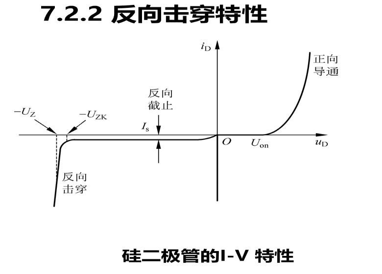

### 2.1 正向特性

- `uD < Uon`：电流很小，这一段称为死区。
- `uD > Uon`：`uD` 微小增加 → `iD` 急剧增大，等效为一个小电阻。
- 硅管导通压降一般取 **0.7 V**。
- 指数方程：

```text
iD = Is·(e^(uD/UT) − 1) ≈ Is·e^(uD/UT)   （正偏时）
```

- **重要结论**：电流每增大 10 倍，电压只需增加 `UT·ln10 ≈ 60 mV`。
  说明正向特性很“陡”，正偏时二极管等效电阻很小。

### 2.2 反向特性

- 反偏时只有少子漂移形成的**反向饱和电流 `Is`**，很小且几乎与反向电压大小无关。
- `Is` 受温度影响很大。

### 2.3 反向击穿

- 反向电压增大到 `UBR` 后，反向电流急剧增大 → **击穿**。
- 普通二极管：应避免（可能损坏）。
- 齐纳二极管：专门工作在击穿区实现稳压（只要电流受限）。
- 注意：**击穿 ≠ 一定烧毁**；烧毁是电流过大 / 过热造成的损坏。

### 2.4 温度特性

- 温度升高时，反向饱和电流 `Is` 增大。
- 测试表明：**温度每升高 10 ℃，`Is` 约增加一倍**：

```text
Is(T2) = Is(T1)·2^((T2−T1)/10)
```

- 特性曲线随温度升高向左移动：同样电流下所需正向电压减小。
- 二极管温度漂移主要来自少子。

### 2.5 一句话总结

二极管是一个“正向导通、反向截止”的非线性电阻；它的电压电流关系是指数型，不是直线。

---

## 3. 二极管的模型（7.3）

### 3.1 三种大信号模型

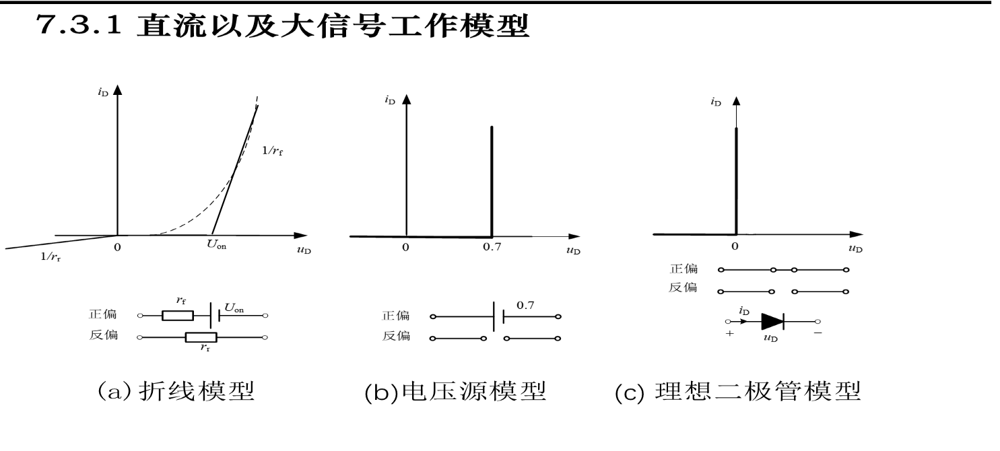

| 模型 | 导通时 | 截止时 | 适用场合 | 记忆 |
|---|---|---|---|---|
| 理想二极管模型 | 短路，压降 0 V | 开路 | 电源电压远大于导通压降；只看波形 / 逻辑 | **0** |
| 恒压降模型 | 0.7 V 电压源 | 开路 | 最常用；一般直流 / 大信号计算 | **0.7** |
| 折线模型 | `Uon + rD`（`rD` 很小） | 开路 | 需要计入导通电阻时 | **Uon + rD** |

- 三种模型都是**分段线性近似**。
- `rD = Δu/Δi`（导通段斜率）。
- 硅管 0.7 V，锗管约 0.3 V（补充）。
- 选择原则：题目没说 → 恒压降模型最稳；说“理想” → 0 V；给出 `rD` / 要求精度 → 折线模型。

**小例（slide 25）**：`UDD = 5 V`，`R = 2 kΩ`，硅管。

```text
理想模型：   ID = 5 V / 2 kΩ = 2.5 mA
恒压降模型： ID = (5 − 0.7) V / 2 kΩ = 2.15 mA
```

同一个电路，模型不同，结果差 0.35 mA；题目要求用哪个模型，就按哪个算。

### 3.2 判断二极管通断（大题第一步）

**电压法（推荐）**

1. 先假设二极管断开；
2. 求阳极、阴极对同一参考点的电位（或求开路电压 `uD`）；
3. 若 `uD > Uon`（硅管约 0.5～0.7 V，理想模型 0 V）→ 正偏导通；否则截止；
4. 导通后用 0.7 V 电压源（或 0 V）替代，再解电路。

**电流法**

- 假设二极管短路，求回路电流方向；与二极管箭头方向一致 → 导通；相反 → 截止。

**多只二极管**

- 分别求各管开路电压，**开路电压大的优先导通**；
- 该管导通后，再根据电路约束重新判断其余管；
- 注意：优先导通后可能把另一只管的阳极电位拉低，使其截止。

**例（PPT 7.3 例）**：D 阳极接 −4 V，阴极接 −10 V → 阳极电位高于阴极，D 导通；用理想模型，压降为 0 → A 点电位就是 −4 V，即 `uAO = −4 V`。

### 3.3 图解法与静态工作点 Q

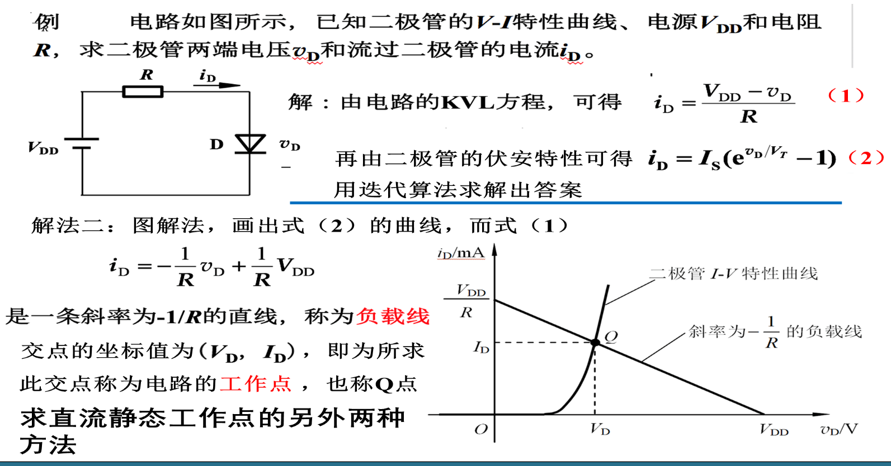

- 回路 KVL：

```text
vD = VDD − iD·R
iD = (VDD − vD)/R = −(1/R)·vD + VDD/R
```

- 这是一条斜率为 `−1/R`、纵截距 `VDD/R`、横截距 `VDD` 的直线 → **负载线**。
- 负载线与二极管伏安特性的交点 = **工作点 Q（VD, ID）**。
- 另一种方法：联立

```text
(1) iD = (VDD − vD)/R
(2) iD = Is·(e^(vD/UT) − 1)
```

用迭代法求解。
- Q 点既是直流工作点，也是小信号模型线性化的切点。

### 3.4 小信号模型（交流分析）

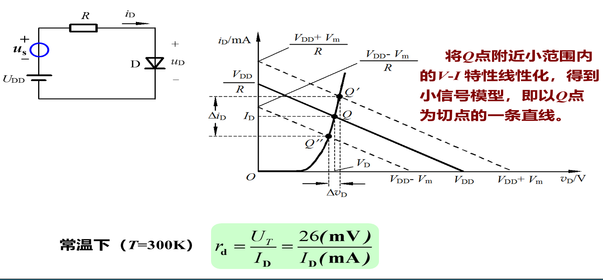

**适用条件**：在直流偏置 Q 点上叠加一个幅度很小的交流信号（小信号）。

**思路**：在 Q 点作切线，用切线斜率代替曲线 → 动态电阻 `rd`。

```text
rd = ΔuD/ΔiD |Q = UT/ID ≈ 26 mV / ID(mA)   （Ω）
```

- `ID` 越大，`rd` 越小（正偏越深，电阻越小）。

**四步法（考试模板）**

1. **直流通路**：交流源置 0（`us` 短路），用恒压降模型求 `ID`、`UO`；
2. 求 `rd = 26 mV / ID`；
3. **交流通路**：直流电源置 0（`VDD` 短路到地），电容短路，二极管用 `rd` 代替；求交流量 `uo`；
4. **叠加**：`uO = UO + uo`。

**PPT 例**：`UDD = 5 V`，`R = 5 kΩ`，恒压降模型 `UD = 0.7 V`，`us = 0.1·sinωt V`。

- 直流：`ID = (5 − 0.7)/5k = 0.86 mA`；`UO = ID·R = 4.3 V`。
- 小信号电阻：`rd = 26 mV / 0.86 mA ≈ 30.2 Ω`。
- 交流：`uo = R/(R+rd)·us = 5000/5030.2 × 0.1·sinωt ≈ 0.0994·sinωt V`。
- 总量：

```text
uO = UO + uo = 4.3 + 0.0994·sinωt  (V)
```

- 注意：交流量约 0.1 V，远小于 `UT` 的量级要求，符合小信号条件。

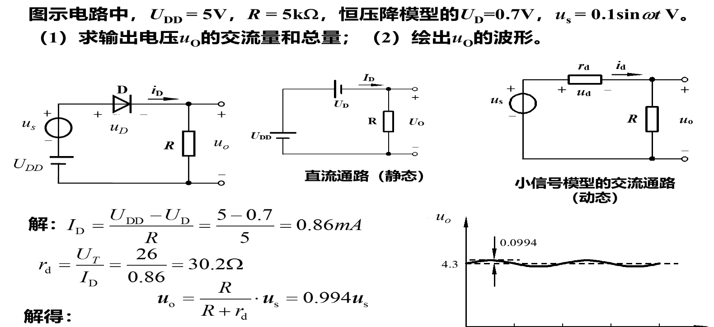

### 3.5 模型选择总结

| 场景 | 用什么模型 |
|---|---|
| 只判断导通 / 截止、电源电压很大 | 理想模型 |
| 求直流工作点、一般大题 | 恒压降模型（0.7 V） |
| 需要计入导通电阻 | 折线模型 |
| 直流偏置 + 小幅交流 | 先大信号求 Q，再用小信号 `rd` |
| 求波形 / 传输特性 | 恒压降或理想，分段讨论 |

**常见错误**

- 用小信号模型求直流工作点（错，`rd` 依赖 `ID`）；
- 交流通路中忘记把直流电源置零；
- 把 `rd` 当成常数（它随 `ID` 变化）；
- 忽略二极管导通后电路其它部分的变化。

---

## 4. 二极管应用电路（7.4）

### 4.1 整流器

#### 半波整流

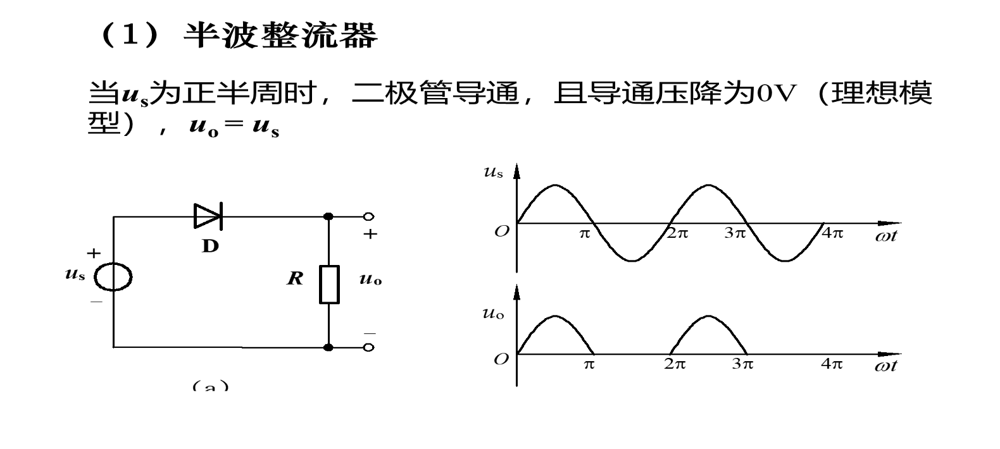

- 电路：交流源 `us` + 二极管 D + 负载 R。
- `us` 正半周：D 导通（理想模型），`uo = us`。
- `us` 负半周：D 截止，`uo = 0`。
- 输出：只有正半周的脉动直流。
- 二极管承受的最大反向电压：`Um`（补充）。
- 输出平均值（补充）：`Uo(av) = Um/π ≈ 0.318Um`。

#### 全波整流（中心抽头）

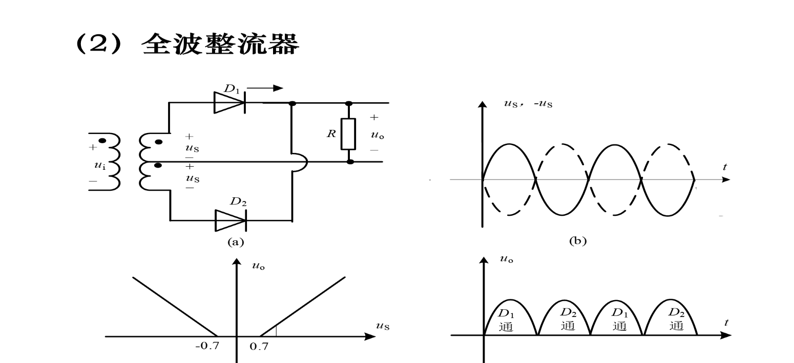

- 变压器副边中心抽头接地，两只二极管 D1、D2 轮流导通。
- `us` 正半周：D1 导通；负半周：D2 导通；输出为 `|us|` 的脉动波形。
- 传输特性：`|us| > 0.7 V` 才有输出，存在 ±0.7 V 死区。
- 每只二极管承受的最大反向电压：`2Um`（补充）。
- 输出平均值（补充）：`Uo(av) = 2Um/π ≈ 0.637Um`。
- 与半波相比：全波频率翻倍、脉动小，但变压器要求高。

**波形题步骤**

1. 标出输入的正 / 负半周；
2. 判断每个半周哪些二极管导通；
3. 导通管用 0.7 V 源替代（或短路），截止管用开路；
4. 画输出波形，标出幅值和转折点。

### 4.2 峰值检测电路

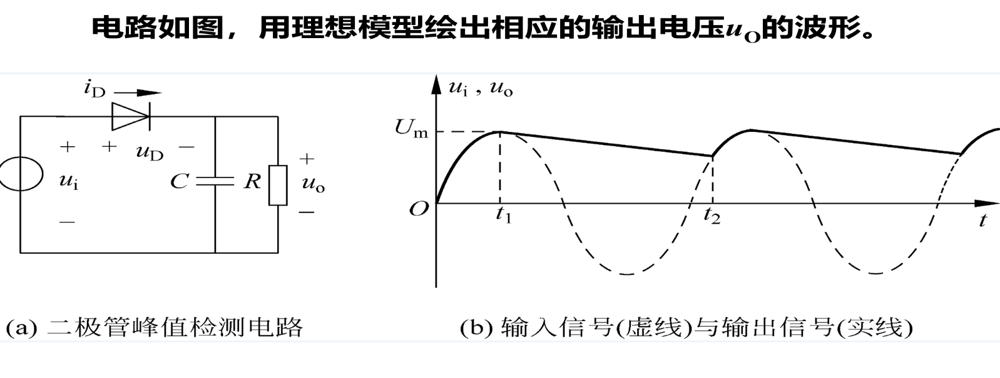

- 电路：D 串联，C 并联 R（输出）。
- 输入正半周：D 导通，C 充电到输入峰值 `Um`；
- 输入下降：D 截止，C 经 R 缓慢放电，输出基本保持在峰值附近（有下垂）；
- 下一个正半周若输入超过当前输出，D 再次导通补电。
- 用途：测峰值、检波。
- 与整流滤波的区别：峰值检测的放电很慢，输出是输入信号的“包络”。

### 4.3 限幅电路

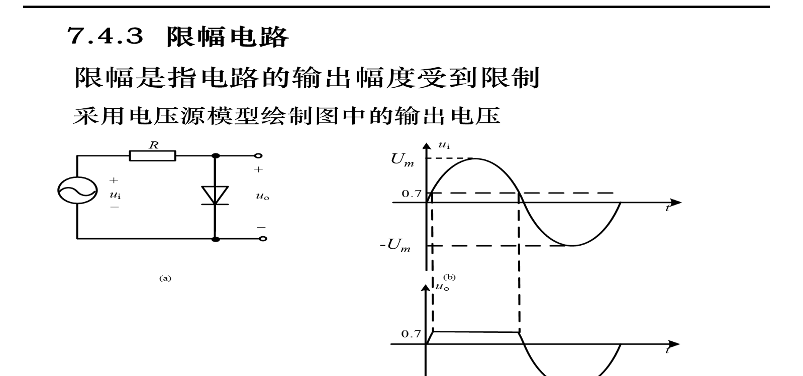

- 作用：输出幅度被限制在某个电平，超出部分被“削掉”。
- 电路：R 串联，二极管（可串联参考电压源）并联在输出端。
- 分析：先假设 D 截止 → `uo = ui`；若 `uo` 使 D 正偏且大于 0.7 V → D 导通，`uo` 被钳在 0.7 V（或 `0.7 + |Vref|`）。
- PPT 例 1（slide 33）：D 阳极接输出、阴极接地 → 正半周被限在 **+0.7 V**，负半周到 `−Um`。
  传输特性：`uo = min(ui, 0.7)`。
- PPT 例 2（slide 34）：`R = 1 kΩ`，硅管，`ui = 5·sinωt V`，D 与 2 V 电源串联，等效参考为 −2 V → 输出下限 **−2.7 V**；其余时间 `uo = ui`。

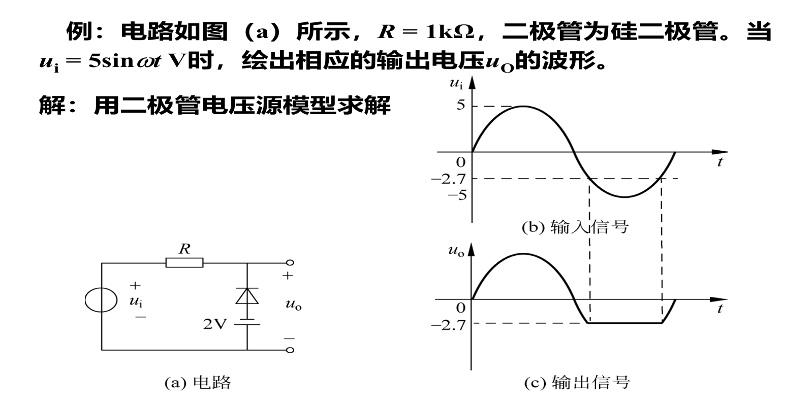

- **限幅 = 削掉“超出部分”，波形形状改变。**
- 转折点：`ui = ±(0.7 + Vref)`。

### 4.4 钳位电路

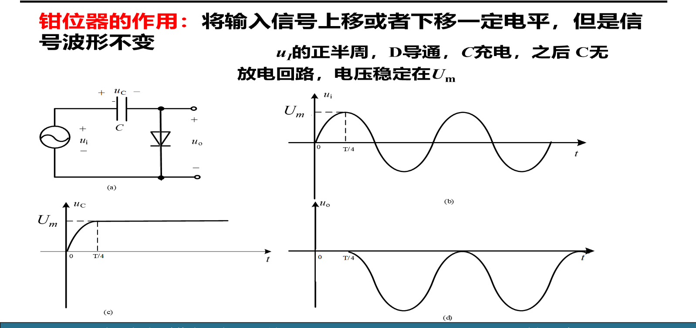

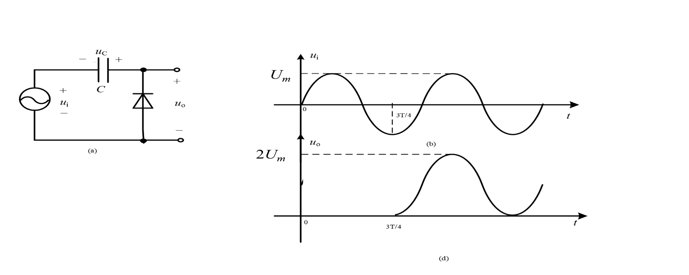

- 作用：把整个波形上移或下移一定电平，**波形形状不变**。
- 电路：C 串联 + 二极管并联在输出端。
- 原理：二极管导通半周给 C 充电到 `Um`；之后 D 截止，C 无放电回路，电压保持，相当于一个电压源串在输入和输出之间。
- 分析要点（PPT 4 条）：
  1. 从二极管导通的半个周期开始分析；
  2. 二极管导通时 C 充电；截止时 C 无放电路径，两端电压恒定，相当于电压源；
  3. 最终输出波形与原信号相同，只是电平进行了移动；
  4. 只需画出稳定后的输出电压波形。
- 两种典型：
  - 二极管阳极接输出、阴极接地（slide 35）：正半周导通，输出被钳到 0 附近 → 输出范围 **0 ~ −2Um**（下移 `Um`）。
  - 二极管阴极接输出、阳极接地（slide 37）：负半周导通，输出被钳到 0 附近 → 输出范围 **0 ~ +2Um**（上移 `Um`）。

**钳位 vs 限幅**

| | 限幅 | 钳位 |
|---|---|---|
| 波形形状 | 改变（削顶） | 不变（整体平移） |
| 元件 | R + D（可带参考源） | C + D |
| 输出 | 被限制在电平内 | 电平被搬移 |
| 典型用途 | 削波、保护 | 恢复直流分量、电平移位 |

### 4.5 二极管逻辑门（与门）

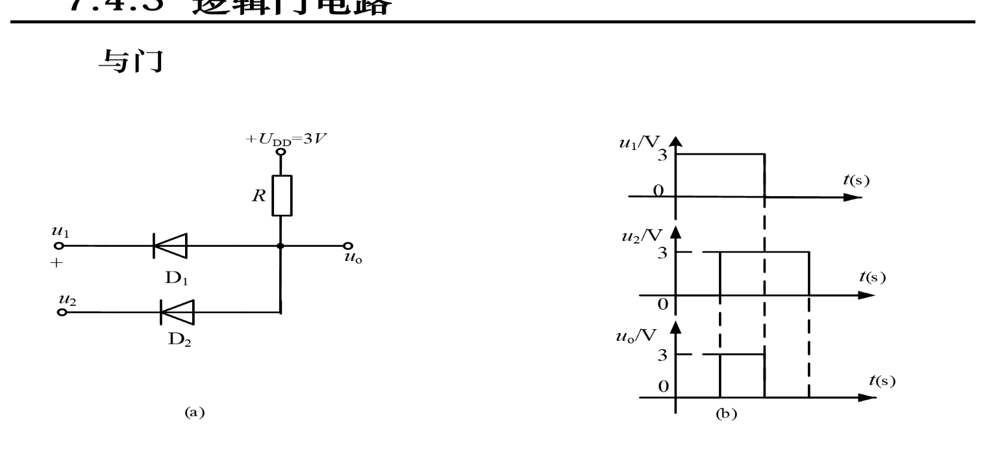

- 电路：两只二极管阳极接输入 `u1`、`u2`，阴极共接输出；输出经 R 接 `+UDD`（3 V）。
- 原理：
  - 任一输入为 0：对应二极管导通，输出被拉低到 ≈0（理想）或 0.7 V（实际）；
  - 两输入都为 3 V：二极管都截止，输出被 R 拉到 3 V。
- 真值表：

| u1 | u2 | uo |
|---|---|---|
| 0 | 0 | 0 |
| 0 | 3 | 0 |
| 3 | 0 | 0 |
| 3 | 3 | 3 |

- 结论：**全 1 出 1，有 0 出 0** → 与门。
- 实际二极管门存在电平偏移（低电平约 0.7 V）、速度慢，后续由 CMOS/TTL 取代。

---

## 5. 齐纳二极管与稳压电路（7.6）

### 5.1 符号与特性

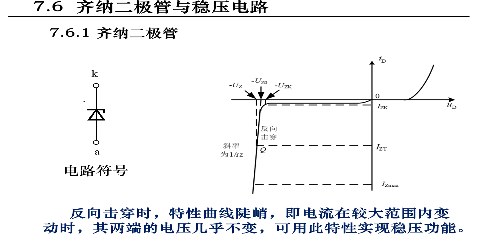

- 符号：与普通二极管类似，阴极带“弯折”横条；正常使用时**反向偏置**。
- 工作区：反向击穿区。击穿后特性曲线很陡：电流在较大范围变化，电压几乎不变 → 稳压。
- 参数：

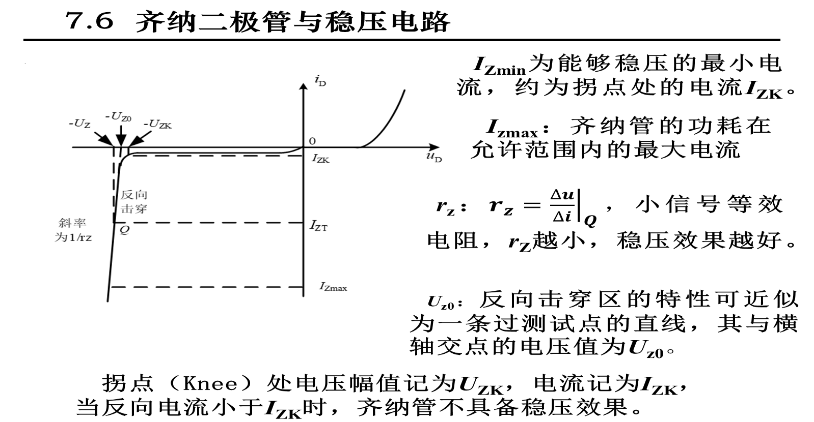

| 参数 | 含义 | 记忆 |
|---|---|---|
| `UZ` | 额定稳压值（测试电流 `IZT` 下） | 标称值 |
| `IZmin ≈ IZK` | 能稳压的最小电流（拐点） | 小于它 → 稳压失效 |
| `IZmax` | 允许的最大电流（受功耗限制） | 超过 → 烧毁 |
| `rz` | 击穿区动态电阻 `rz = Δu/Δi` | 越小稳压效果越好 |
| `UZ0` | 击穿区直线与横轴交点 | 理想电压源值 |
| `PZ` | 最大功耗 `PZ = UZ·IZmax` | 选型用 |

- 关系（在测试点）：

```text
UZ = UZ0 + IZ·rz
UZ0 = UZ − IZ·rz
```

- 注意：`rz` 通常为几欧～几十欧，计算时与 kΩ 级电阻相比不能忽略，但也不大。

### 5.2 齐纳二极管模型

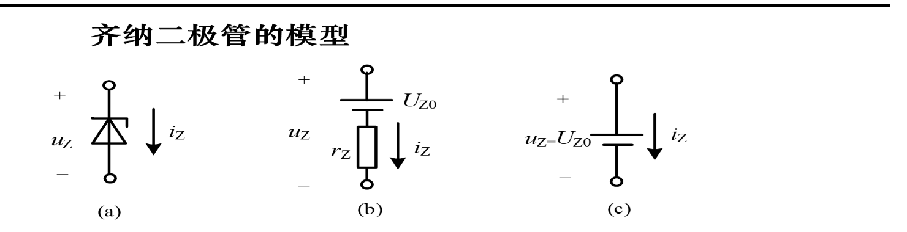

- (a) 符号；
- (b) 实际模型：`UZ0` 串联 `rz`（反向击穿时）；
- (c) 理想模型：`uZ = UZ0`（`rz = 0`）。
- 正偏时它就是普通二极管（0.7 V），但稳压电路中必须反偏。

### 5.3 稳压电路分析（四步法）

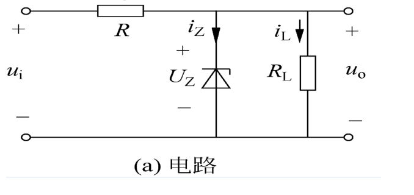

电路：`ui` 经限流电阻 R 接到稳压管阴极，稳压管阳极接地；`RL` 与稳压管并联，输出 `uo`。

1. **断开稳压管**，求其两端戴维南等效：`Uth`（开路电压）、`Rth`（等效电阻）。
2. **判断状态**：
   - `Uth < UZ0` → 稳压管截止（未击穿）→ `iz = 0`，`uo = Uth`；
   - `Uth > UZ0` → 稳压管击穿稳压 → 进入第 3 步。
3. **计算击穿状态**：

```text
iz = (Uth − UZ0)/(Rth + rz)
uo = UZ0 + iz·rz
```

4. **校验**：`IZmin ≤ iz ≤ IZmax`。不满足 → 不能稳压 / 会损坏，需重新设计 R 或选管。

> 记忆：**先断开、求戴维南；比 UZ0、判通断；算 iz、代模型；最后校验 IZmin/IZmax。**

### 5.4 PPT 例题（重点，考试同型）

已知：`UZ = 6.8 V`（`IZT = 5 mA`），`rz = 20 Ω`，`IZK = 0.2 mA`，`ui = 10 V`，`R = 0.5 kΩ`。

先求：

```text
UZ0 = UZ − IZT·rz = 6.8 − 5 mA × 20 Ω = 6.8 − 0.1 = 6.7 V
```

注意单位：`20 Ω = 0.02 kΩ`。

**(1) RL 开路**

```text
iz = (ui − UZ0)/(R + rz) = (10 − 6.7)/(0.5 + 0.02) = 3.3/0.52 = 6.35 mA
uo = UZ0 + iz·rz = 6.7 + 6.35 mA × 0.02 kΩ = 6.7 + 0.127 = 6.83 V
```

校验：`0.2 mA < 6.35 mA`（`IZmax` 未给，需查手册）。

**(2) RL = 0.5 kΩ**

```text
断开稳压管：Uth = RL/(R+RL)·ui = 0.5/(0.5+0.5) × 10 = 5 V
Rth = R∥RL = 0.25 kΩ
Uth = 5 V < UZ0 = 6.7 V → 稳压管截止，iz = 0，uo = 5 V
```

此时它就是一个普通分压电路，没有稳压作用。

**(3) RL = 2 kΩ**

```text
断开：Uth = 2/(0.5+2) × 10 = 8 V
Rth = 0.5∥2 = 0.4 kΩ
Uth = 8 V > 6.7 V → 击穿稳压
iz = (8 − 6.7)/(0.4 + 0.02) = 1.3/0.42 = 3.095 mA
uo = 6.7 + 3.095 × 0.02 = 6.7 + 0.0619 = 6.76 V
```

校验：`iz > IZK = 0.2 mA`，稳压有效（`IZmax` 需查手册）。

**结论**：同一电路，负载越重（`RL` 越小），`Uth` 越低；当 `Uth < UZ0` 时稳压管截止，输出随负载分压下降，失去稳压。

### 5.5 稳压条件与选型

- 稳压管必须**反向接**；正接只会 0.7 V 导通。
- 输入电压最低、负载最重时，仍要保证 `iz ≥ IZmin`；
- 输入电压最高、负载最轻时，要保证 `iz ≤ IZmax`（受 `PZ` 限制）。
- 限流电阻 R 的选择（补充公式，帮助理解）：

```text
R ≤ (ui(min) − UZ)/(IZmin + IL(max))
R ≥ (ui(max) − UZ)/(IZmax + IL(min))
```

- 稳压值有限，且温度系数随 `UZ` 大小变化（补充，不展开）。

---

## 6. 二极管的电容效应（PPT 45–47）

### 6.1 势垒电容 CB

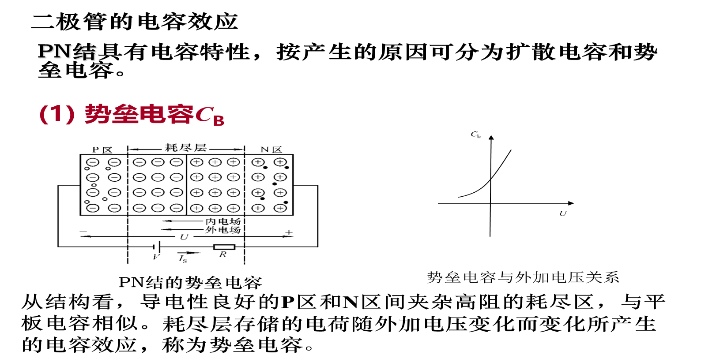

- 结构：P 区、N 区导电性好，中间耗尽层高阻 → 类似平板电容。
- 耗尽层存储的电荷随外加电压变化 → **势垒电容**。
- 反偏时耗尽层变宽，`CB` 起主要作用；`CB` 随反偏电压增大而减小（PPT 曲线以正偏电压为横轴，正偏越大 `CB` 越大）。

### 6.2 扩散电容 CD

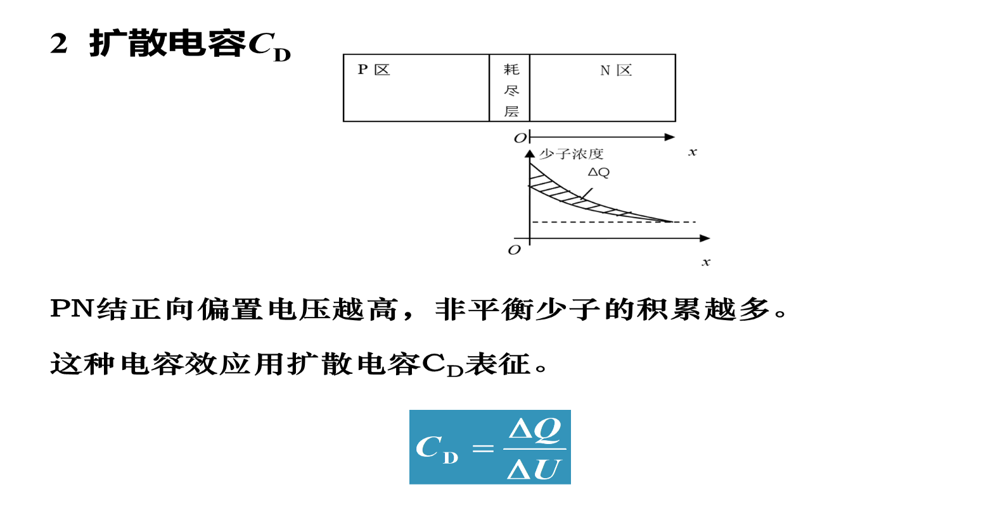

- 正偏时，非平衡少子在扩散区积累；正向电压越高，积累越多。
- `CD = ΔQ/ΔU`。
- 正偏时 `CD` 起主要作用，通常比 `CB` 大。

### 6.3 总结

| 电容 | 产生原因 | 主要工作区 | 与电压关系 |
|---|---|---|---|
| `CB` | 耗尽层电荷随电压变化 | 反偏 | 反偏越深，`CB` 越小 |
| `CD` | 非平衡少子积累随电压变化 | 正偏 | 正偏越高，`CD` 越大 |

- 二极管高频模型 = 理想二极管 + 结电容（`CB∥CD`）+ 体电阻等。
- 影响：高频整流 / 检波效率下降；开关时间变长。
- slide 47：对称 PN 结 vs 不对称 P⁺N 结。实际二极管多为 P⁺N 不对称结，结电容主要由轻掺杂一侧决定（补充解释）。

---

## 7. 易错点 & 考点清单

| 易错点 | 正确做法 |
|---|---|
| 把 N 型半导体当成带负电 | 整体电中性，只是多子为电子 |
| 认为空穴真的在移动 | 空穴导电是价电子依次填补 |
| 正偏 / 反偏看电源方向 | 看 P 区电位是否高于 N 区 |
| 判断导通先算电流 | 先断开求开路电压（电压法） |
| 多二极管随便假设一个导通 | 开路电压大的优先导通 |
| 小信号模型求直流 | 小信号只能求交流量，先大信号求 Q |
| 交流通路忘记电源置零 | 直流电压源短路、电流源开路 |
| 限幅 / 钳位混淆 | 限幅削幅（形状变），钳位搬电平（形状不变） |
| 钳位从任意时刻开始画 | 从二极管导通的半周开始分析 |
| 稳压管正接 | 必须反接；先断后比再校验 |
| `rz` 单位 | `20 Ω = 0.02 kΩ`，别和 kΩ 混 |
| 击穿 = 烧毁 | 击穿可恢复，烧毁是过热损坏 |
| 忽略温度 | `Is` 每 10 ℃ 翻倍，少子主导 |

**波形题检查清单**

1. 正 / 负半周分别分析；
2. 导通用 0.7 V 源替代，截止用开路；
3. 标出转折点电压（0.7、−2.7、±Um、±2Um 等）；
4. 检查波形形状（限幅削顶 vs 钳位平移）；
5. 检查二极管反向电压是否超过 `UBR`。

---

## 8. 考前自测（13 题）

1. N 型半导体中多数载流子是什么？少子是什么？不能移动的离子带什么电？
2. 为什么杂质半导体的多子浓度基本不随温度变化，而少子浓度随温度变化明显？
3. PN 结正偏时，空间电荷区变宽还是变窄？扩散和漂移谁占优势？
4. 硅二极管的正向导通压降一般取多少？死区电压大约是多少？
5. 二极管正向电流增大 10 倍，电压大约增加多少？说明什么？
6. 温度升高 10 ℃，反向饱和电流约如何变化？写出公式。
7. 如何用电压法判断二极管是否导通？多只二极管时先判断哪只？
8. 理想模型、恒压降模型、折线模型有什么区别？各适用于什么场合？
9. 已知 `ID = 1 mA`，求小信号电阻 `rd`；若 `ID` 增大到 2 mA，`rd` 如何变化？
10. 半波整流和全波整流的输出波形有什么区别？各用几只二极管？
11. 限幅电路和钳位电路的区别是什么？
12. 稳压管稳压的条件是什么？如何判断它是否工作在击穿区？
13. 稳压管电路中，`UZ = 6 V`，`rz = 10 Ω`，`IZT = 5 mA`，求 `UZ0`。

---

## 9. 自测答案

1. 多子电子，少子空穴，正离子。
2. 多子由掺杂浓度决定；少子由本征激发产生，浓度低且强烈依赖温度。
3. 变窄；扩散 > 漂移。
4. 0.7 V；死区约 0.5 V（硅）。
5. 约 60 mV；说明正偏特性很陡，等效电阻很小。
6. 约翻倍；`Is(T2) = Is(T1)·2^((T2−T1)/10)`。
7. 断开二极管，求开路电压；正偏且大于死区电压 → 导通。多管时开路电压大的优先导通。
8. 理想：导通 0 V；恒压降：导通 0.7 V；折线：导通 `Uon + rD`。分别用于粗略波形 / 逻辑、一般直流计算、需要计入导通电阻的精确计算。
9. `rd = 26 mV / 1 mA = 26 Ω`；`ID` 增大到 2 mA，`rd ≈ 13 Ω`，减小。
10. 半波只保留正半周；全波把负半周翻到正半周，频率翻倍；半波 1 只，全波 2 只（中心抽头）。
11. 限幅削掉超出部分，波形形状改变；钳位整体平移电平，波形形状不变。
12. 反向击穿且 `IZmin ≤ iz ≤ IZmax`；先断开稳压管求 `Uth`，`Uth > UZ0` 即击穿。
13. `UZ0 = 6 − 5 mA × 10 Ω = 6 − 0.05 = 5.95 V`。

---

## 10. 公式速查

```text
二极管指数方程：   iD = Is·(e^(uD/UT) − 1) ≈ Is·e^(uD/UT)   （正偏）
热电压：           UT ≈ 26 mV（T = 300 K）
电流每增 10 倍：   ΔuD ≈ UT·ln10 ≈ 60 mV

温度特性：         Is(T2) = Is(T1)·2^((T2−T1)/10)

小信号电阻：       rd = UT/ID ≈ 26 mV / ID(mA)      （Ω）

负载线：           iD = (VDD − vD)/R = −(1/R)·vD + VDD/R
工作点：           负载线与二极管伏安特性的交点 Q(VD, ID)

半波整流（补充）： Uo(av) = Um/π ≈ 0.318Um
全波整流（补充）： Uo(av) = 2Um/π ≈ 0.637Um

齐纳管测试点：     UZ = UZ0 + IZ·rz  →  UZ0 = UZ − IZ·rz
稳压管电流：       iz = (Uth − UZ0)/(Rth + rz)
稳压输出电压：     uo = UZ0 + iz·rz
稳压条件：         IZmin ≤ iz ≤ IZmax

限流电阻（补充）： R ≤ (ui(min) − UZ)/(IZmin + IL(max))
                   R ≥ (ui(max) − UZ)/(IZmax + IL(min))

扩散电容：         CD = ΔQ/ΔU
```

---

## 11. 附：PPT 页面索引

| PPT 页 | 内容 |
|---|---|
| 1–2 | 章节标题 / 目录 |
| 3–10 | 半导体基础、N / P 型半导体 |
| 11–13 | PN 结、正偏 |
| 14–20 | 二极管特性、反向击穿、温度特性 |
| 21–29 | 大小信号模型、通断判断、图解法、小信号分析 |
| 30–31 | 半波 / 全波整流 |
| 32 | 峰值检测 |
| 33–34 | 限幅 |
| 35–37 | 钳位 |
| 38 | 二极管与门 |
| 39–44 | 齐纳二极管、稳压电路与例题 |
| 45–47 | 二极管电容效应 |

> 说明：PPT 目录列有“7.5 特殊二极管”，但本套幻灯片未展开光电 / 发光 / 变容等特殊二极管，重点落在 7.6 齐纳二极管与稳压电路；如果老师课上补充，按老师要求记。


## 附：图片清单（手机 App 内点开查看）

> GitHub 手机 App 不渲染 Markdown 里的相对路径图片（已知缺陷）。
> 在 App 里点下面的链接可直接打开对应图片；用手机/电脑浏览器阅读则图片会正常内嵌显示。

| # | 图片 | 所属章节 |
|---|---|---|
| 1 | [N 型半导体结构](https://raw.githubusercontent.com/JZG-1/study_materials/main/%E6%A8%A1%E7%94%B5/%E7%AC%AC7%E7%AB%A0_%E4%BA%8C%E6%9E%81%E7%AE%A1%E5%8F%8A%E5%85%B6%E5%BA%94%E7%94%A8%E7%94%B5%E8%B7%AF/images/fig_n_type.png) | 1.3 杂质半导体（选择题常考） |
| 2 | [P 型半导体结构](https://raw.githubusercontent.com/JZG-1/study_materials/main/%E6%A8%A1%E7%94%B5/%E7%AC%AC7%E7%AB%A0_%E4%BA%8C%E6%9E%81%E7%AE%A1%E5%8F%8A%E5%85%B6%E5%BA%94%E7%94%A8%E7%94%B5%E8%B7%AF/images/fig_p_type.png) | 1.3 杂质半导体（选择题常考） |
| 3 | [PN结与空间电荷区](https://raw.githubusercontent.com/JZG-1/study_materials/main/%E6%A8%A1%E7%94%B5/%E7%AC%AC7%E7%AB%A0_%E4%BA%8C%E6%9E%81%E7%AE%A1%E5%8F%8A%E5%85%B6%E5%BA%94%E7%94%A8%E7%94%B5%E8%B7%AF/images/fig_pn_junction.png) | 1.4 PN 结（本章的地基） |
| 4 | [正偏/反偏时空间电荷区的变化](https://raw.githubusercontent.com/JZG-1/study_materials/main/%E6%A8%A1%E7%94%B5/%E7%AC%AC7%E7%AB%A0_%E4%BA%8C%E6%9E%81%E7%AE%A1%E5%8F%8A%E5%85%B6%E5%BA%94%E7%94%A8%E7%94%B5%E8%B7%AF/images/fig_bias_explained.png) | 1.4.1 直观理解：为什么正偏窄、反偏宽？ |
| 5 | [硅二极管的 I-V 特性](https://raw.githubusercontent.com/JZG-1/study_materials/main/%E6%A8%A1%E7%94%B5/%E7%AC%AC7%E7%AB%A0_%E4%BA%8C%E6%9E%81%E7%AE%A1%E5%8F%8A%E5%85%B6%E5%BA%94%E7%94%A8%E7%94%B5%E8%B7%AF/images/fig_iv.png) | 2. 二极管的伏安特性（7.2） |
| 6 | [三种大信号模型](https://raw.githubusercontent.com/JZG-1/study_materials/main/%E6%A8%A1%E7%94%B5/%E7%AC%AC7%E7%AB%A0_%E4%BA%8C%E6%9E%81%E7%AE%A1%E5%8F%8A%E5%85%B6%E5%BA%94%E7%94%A8%E7%94%B5%E8%B7%AF/images/fig_models.png) | 3.1 三种大信号模型 |
| 7 | [负载线与 Q 点](https://raw.githubusercontent.com/JZG-1/study_materials/main/%E6%A8%A1%E7%94%B5/%E7%AC%AC7%E7%AB%A0_%E4%BA%8C%E6%9E%81%E7%AE%A1%E5%8F%8A%E5%85%B6%E5%BA%94%E7%94%A8%E7%94%B5%E8%B7%AF/images/fig_load_line.png) | 3.3 图解法与静态工作点 Q |
| 8 | [小信号模型](https://raw.githubusercontent.com/JZG-1/study_materials/main/%E6%A8%A1%E7%94%B5/%E7%AC%AC7%E7%AB%A0_%E4%BA%8C%E6%9E%81%E7%AE%A1%E5%8F%8A%E5%85%B6%E5%BA%94%E7%94%A8%E7%94%B5%E8%B7%AF/images/fig_small_signal.png) | 3.4 小信号模型（交流分析） |
| 9 | [小信号分析例题](https://raw.githubusercontent.com/JZG-1/study_materials/main/%E6%A8%A1%E7%94%B5/%E7%AC%AC7%E7%AB%A0_%E4%BA%8C%E6%9E%81%E7%AE%A1%E5%8F%8A%E5%85%B6%E5%BA%94%E7%94%A8%E7%94%B5%E8%B7%AF/images/fig_small_signal_example.png) | 3.4 小信号模型（交流分析） |
| 10 | [半波整流](https://raw.githubusercontent.com/JZG-1/study_materials/main/%E6%A8%A1%E7%94%B5/%E7%AC%AC7%E7%AB%A0_%E4%BA%8C%E6%9E%81%E7%AE%A1%E5%8F%8A%E5%85%B6%E5%BA%94%E7%94%A8%E7%94%B5%E8%B7%AF/images/fig_half_wave.png) | 4.1 整流器 |
| 11 | [全波整流](https://raw.githubusercontent.com/JZG-1/study_materials/main/%E6%A8%A1%E7%94%B5/%E7%AC%AC7%E7%AB%A0_%E4%BA%8C%E6%9E%81%E7%AE%A1%E5%8F%8A%E5%85%B6%E5%BA%94%E7%94%A8%E7%94%B5%E8%B7%AF/images/fig_full_wave.png) | 4.1 整流器 |
| 12 | [峰值检测电路](https://raw.githubusercontent.com/JZG-1/study_materials/main/%E6%A8%A1%E7%94%B5/%E7%AC%AC7%E7%AB%A0_%E4%BA%8C%E6%9E%81%E7%AE%A1%E5%8F%8A%E5%85%B6%E5%BA%94%E7%94%A8%E7%94%B5%E8%B7%AF/images/fig_peak.png) | 4.2 峰值检测电路 |
| 13 | [限幅电路](https://raw.githubusercontent.com/JZG-1/study_materials/main/%E6%A8%A1%E7%94%B5/%E7%AC%AC7%E7%AB%A0_%E4%BA%8C%E6%9E%81%E7%AE%A1%E5%8F%8A%E5%85%B6%E5%BA%94%E7%94%A8%E7%94%B5%E8%B7%AF/images/fig_limiter.png) | 4.3 限幅电路 |
| 14 | [限幅例题](https://raw.githubusercontent.com/JZG-1/study_materials/main/%E6%A8%A1%E7%94%B5/%E7%AC%AC7%E7%AB%A0_%E4%BA%8C%E6%9E%81%E7%AE%A1%E5%8F%8A%E5%85%B6%E5%BA%94%E7%94%A8%E7%94%B5%E8%B7%AF/images/fig_limiter_example.png) | 4.3 限幅电路 |
| 15 | [钳位电路（下移）](https://raw.githubusercontent.com/JZG-1/study_materials/main/%E6%A8%A1%E7%94%B5/%E7%AC%AC7%E7%AB%A0_%E4%BA%8C%E6%9E%81%E7%AE%A1%E5%8F%8A%E5%85%B6%E5%BA%94%E7%94%A8%E7%94%B5%E8%B7%AF/images/fig_clamp_neg.png) | 4.4 钳位电路 |
| 16 | [钳位电路（上移）](https://raw.githubusercontent.com/JZG-1/study_materials/main/%E6%A8%A1%E7%94%B5/%E7%AC%AC7%E7%AB%A0_%E4%BA%8C%E6%9E%81%E7%AE%A1%E5%8F%8A%E5%85%B6%E5%BA%94%E7%94%A8%E7%94%B5%E8%B7%AF/images/fig_clamp_pos.png) | 4.4 钳位电路 |
| 17 | [二极管与门](https://raw.githubusercontent.com/JZG-1/study_materials/main/%E6%A8%A1%E7%94%B5/%E7%AC%AC7%E7%AB%A0_%E4%BA%8C%E6%9E%81%E7%AE%A1%E5%8F%8A%E5%85%B6%E5%BA%94%E7%94%A8%E7%94%B5%E8%B7%AF/images/fig_logic_and.png) | 4.5 二极管逻辑门（与门） |
| 18 | [齐纳二极管符号与特性](https://raw.githubusercontent.com/JZG-1/study_materials/main/%E6%A8%A1%E7%94%B5/%E7%AC%AC7%E7%AB%A0_%E4%BA%8C%E6%9E%81%E7%AE%A1%E5%8F%8A%E5%85%B6%E5%BA%94%E7%94%A8%E7%94%B5%E8%B7%AF/images/fig_zener_symbol.png) | 5.1 符号与特性 |
| 19 | [齐纳二极管参数](https://raw.githubusercontent.com/JZG-1/study_materials/main/%E6%A8%A1%E7%94%B5/%E7%AC%AC7%E7%AB%A0_%E4%BA%8C%E6%9E%81%E7%AE%A1%E5%8F%8A%E5%85%B6%E5%BA%94%E7%94%A8%E7%94%B5%E8%B7%AF/images/fig_zener_params.png) | 5.1 符号与特性 |
| 20 | [齐纳二极管模型](https://raw.githubusercontent.com/JZG-1/study_materials/main/%E6%A8%A1%E7%94%B5/%E7%AC%AC7%E7%AB%A0_%E4%BA%8C%E6%9E%81%E7%AE%A1%E5%8F%8A%E5%85%B6%E5%BA%94%E7%94%A8%E7%94%B5%E8%B7%AF/images/fig_zener_models.png) | 5.2 齐纳二极管模型 |
| 21 | [稳压电路](https://raw.githubusercontent.com/JZG-1/study_materials/main/%E6%A8%A1%E7%94%B5/%E7%AC%AC7%E7%AB%A0_%E4%BA%8C%E6%9E%81%E7%AE%A1%E5%8F%8A%E5%85%B6%E5%BA%94%E7%94%A8%E7%94%B5%E8%B7%AF/images/fig_zener_circuit.png) | 5.3 稳压电路分析（四步法） |
| 22 | [势垒电容](https://raw.githubusercontent.com/JZG-1/study_materials/main/%E6%A8%A1%E7%94%B5/%E7%AC%AC7%E7%AB%A0_%E4%BA%8C%E6%9E%81%E7%AE%A1%E5%8F%8A%E5%85%B6%E5%BA%94%E7%94%A8%E7%94%B5%E8%B7%AF/images/fig_capacitance.png) | 6.1 势垒电容 CB |
| 23 | [扩散电容](https://raw.githubusercontent.com/JZG-1/study_materials/main/%E6%A8%A1%E7%94%B5/%E7%AC%AC7%E7%AB%A0_%E4%BA%8C%E6%9E%81%E7%AE%A1%E5%8F%8A%E5%85%B6%E5%BA%94%E7%94%A8%E7%94%B5%E8%B7%AF/images/fig_diffusion_cap.png) | 6.2 扩散电容 CD |
<!-- image-index -->
